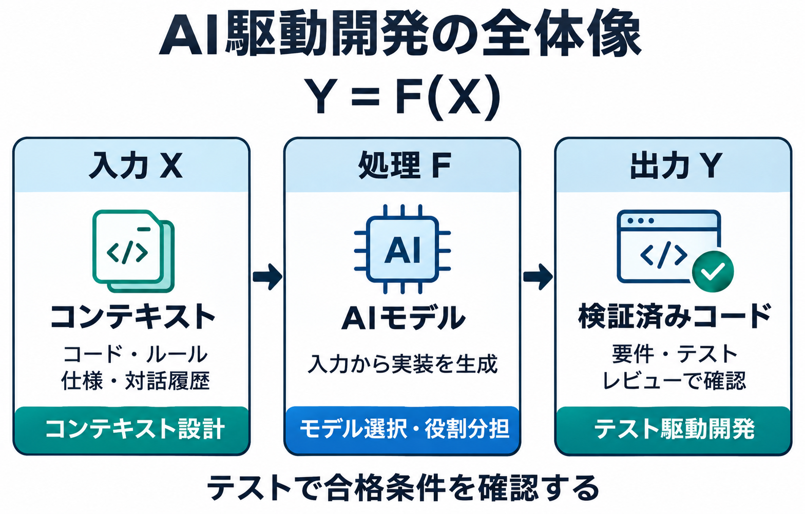
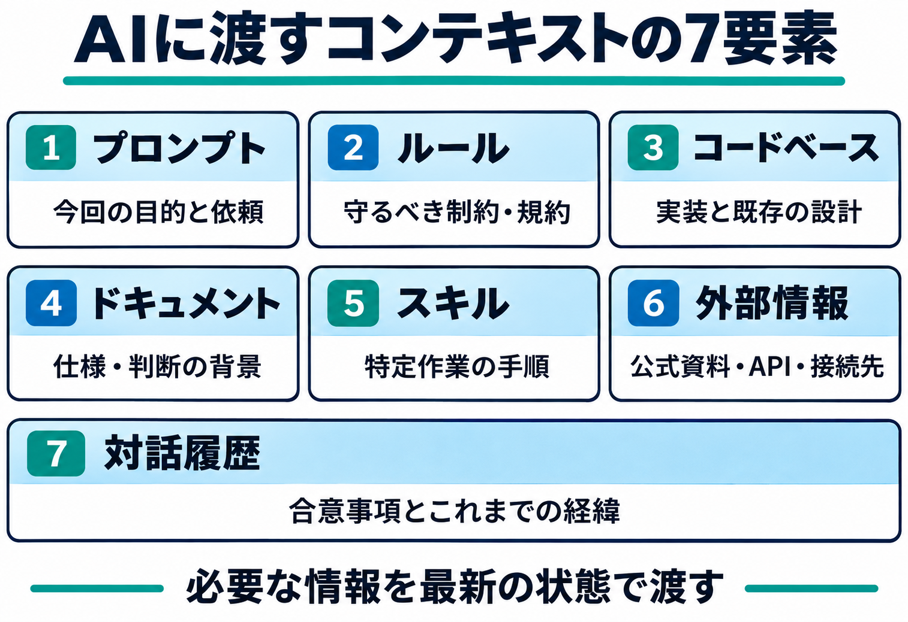
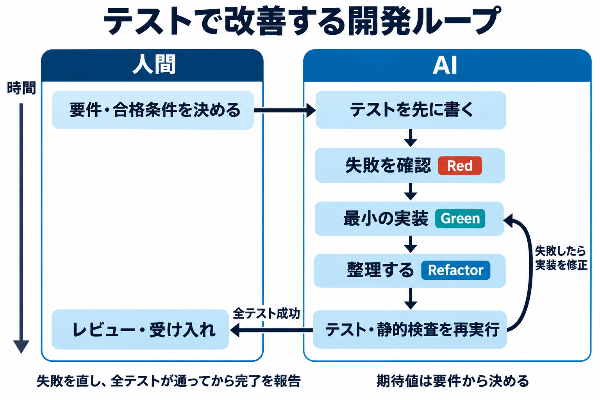
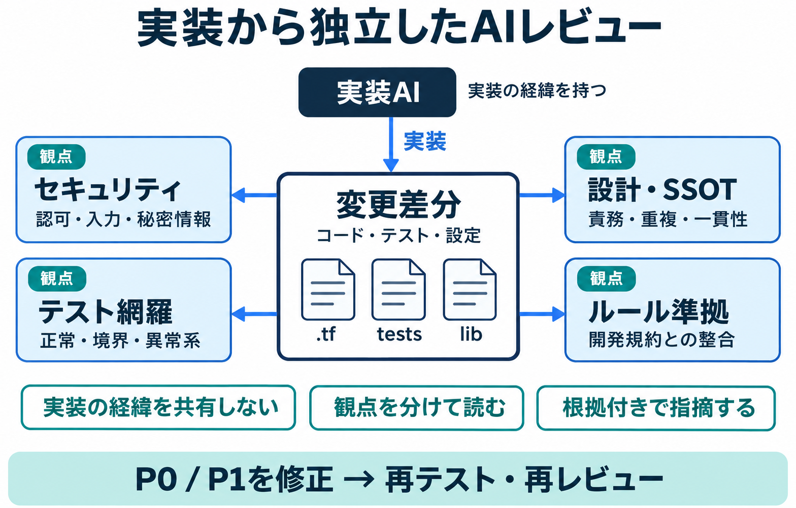
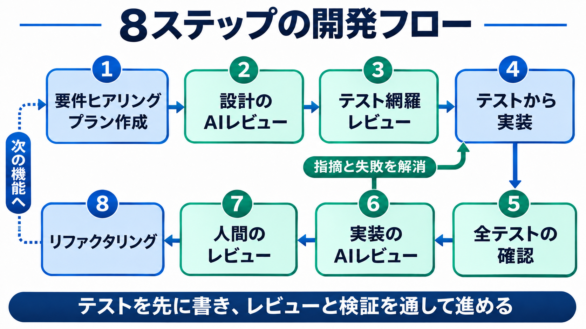

# AI駆動開発 — Codex

# 概要
本ページでは、AI駆動開発の概念と実践方法についてまとめる。

# AI駆動開発とは
AI駆動開発は、AIに指示をしてコードを開発させる開発手法である。

## AI駆動開発における決定論
AI駆動開発は Y = F(X) という式で理解できる。
この式における各変数は以下を意味する。

| 変数 | 意味 |
| --- | --- |
| X | AIへの入力コンテキスト |
| Y | AIからの出力 |
| F | AIのモデル |



つまり、AI駆動開発は、AIに与えるX（コンテキスト）、Y（出力の精査）、F（AIのモデルと使い方）の三つの要素を制御して最高の結果を得ることが重要になる。

## 各変数の制御方針
AI駆動開発において、各変数は以下の方針で制御する。

| 変数 | 制御方法 |
| --- | --- |
| X | コンテキストエンジニアリングによって制御する |
| Y | テスト駆動開発によって制御する |
| F | サブエージェントによるオーケストレーションによって制御する |

この3つのコンテキストエンジニアリング、テスト駆動開発、オーケストレーションがAI駆動開発における根幹である。

## コンテキストエンジニアリング
AIへの入力（コンテキスト）は以下がある。

- プロンプト（AIへの指示）
- ルール（AGENTS.md等）
- コードベース（ソースコードそのもの）
- ドキュメント（要件定義書、仕様書など）
- スキル（何か特定の操作を行うためのノウハウや手順）
- 外部情報（MCPやCLIで取得）
- 対話履歴



コンテキストエンジニアリングはこれらの要素を最適化し、AIから最高の結果を得るための方法論である。
特に、コードベースについては汚染されると、次の X として入力されるため、次の出力も汚染され続ける悪循環の陥る。

コンテキストエンジニアリングの実践内容としては、構造化したルールドキュメント・テスト駆動開発によってコードベースを綺麗に保つ、ドキュメントや外部情報は必要最小限のみ与えるという内容である。

## テスト駆動開発
AIからの出力の特性として、同じ質問をしても同じ内容が必ずしも返ってこない揺れがある。
そのため、AIからの応答の必須条件として、「テストへの合格」を指定することで、出力の品質を確保することが重要である。

テスト駆動開発の実践内容としては、ルールによって実装前に必ずテストを作成する・テスト内容は人間が必ずレビューする・CIによってマージの条件としてテストの合格を必須にするという内容である。



## オーケストレーション
実装させたAIに、レビューをさせると、自己評価が高くなり正常に評価しないという問題がある。
後に説明するが、AIの相互レビューは実装の経緯を知らないAIに観点を分けて（ルール準拠、ファイル構造、SSOT、セキュリティ、テスト）レビューさせる必要がある。
※SSOT：Single Source of Truth（一つの情報の情報源は一つのみにする。ルールの情報源を一つに保つなど）

その際、サブエージェントにレビューを分けてオーケストレーションする方法等を紹介する。

## AI相互レビュー



上記で、X・Y・Fを制御したうえに必要なのがAIによる相互レビューである。

各観点を専門とするレビューエージェントを定義し、テストの合格後にテストでは拾えない観点（ルールへの準拠、SSOT、セキュリティ等）でレビューし、品質を向上させる。

AIレビューの振動を防ぐため、レビューと修正は3周以内に制限させるのが重要である。

# AI駆動開発の実践
ここからは、実際のAI駆動開発の実践方法を例を交えながら紹介する。

まず、リポジトリに必要なルールを置き、その後以下の8ステップで開発するフローをプロンプト例を添えて紹介する。




## 前提
GitHubのリポジトリを使用していること。各社のAI駆動開発のプラクティスはGitHubによるバージョン管理・AIからの読み取り・ブランチによる開発・レビューの仕組みを前提として作られている。

題材を「CAFに沿ったAzure Platform Landing Zoneの新規構築」として例を示す。ルール・レビュー定義・スキル・テスト・プラン・8ステップのプロンプトを一式で示す。

以降の作成先は、リポジトリのルートからの相対パスで示す。

## A.1 リポジトリ装置の実物一式

### A.1.1 リポジトリ全体の指示

作成先：リポジトリ直下の `AGENTS.md`。Codexが作業開始時に読む指示をまとめる。

```markdown
# Azure Platform Landing Zone

CAFに沿った共通基盤を東日本に構築する。管理グループ・Policy・RBAC・監視と、Firewall・DNS・Bastion・ExpressRouteを含むHub-Spokeを対象とする。本ファイルはAIコーディングエージェント向けの地図である。

## 技術スタック

- Terraform 1.12以降と公式AVM（ALZ・Management・Hub-Spoke）、AzureはEA契約
- GitHub Actions + Bash。認証はユーザー割り当てマネージドIDへのOIDCフェデレーション
- 単体・結合はTerraform Test、実AzureのE2EはGo＋Terratest＋testifyで記述する。Azureの実値はCLI／APIで確認する
- E2Eの参照環境：Go 1.23以降、Terratest `v0.48.2`、testify `v1.10.0`

## ディレクトリ構成

- `main.management.groups.tf`、`main.management.resources.tf`、`main.connectivity.tf` — 責務ごとのAVM呼び出し
- `modules/settings/` — 命名・アドレス・Policyパラメータの純粋な変換
- `lib/` — 管理グループ階層・archetype・Policyの定義
- `scripts/` — 実行制御と共通処理
- `tests/` — 単体テスト（unit/）、結合テスト（integration/）、実AzureのE2E（e2e/*_test.go）
- `docs/rules/` — 開発ルール。作業前に下表の該当ファイルを読むこと

## 主要コマンド

- `bash scripts/test.sh unit` / `bash scripts/test.sh e2e` — テスト実行
- `terraform init -backend=false && terraform validate` — 構成検証
- `terraform fmt -check -recursive` — フォーマット検査

## 開発ルールの適用

ファイルを読む・変更する・レビューするときは、対象パスに一致するルールを先に読む。
複数一致した場合はすべて適用する。

| 対象 | 必ず読むルール |
| --- | --- |
| `*.tf`、`modules/**`、`lib/**`、`scripts/**`、`.github/workflows/**` | `docs/rules/architecture.md` |
| `tests/**`、テストの追加・変更 | `docs/rules/testing.md` |
| プルリクエスト前・レビュー実行時 | `docs/rules/review.md` |

- ルールと仕様書が矛盾した場合は、推測で進めず作業を止めて矛盾を報告する
```

ルール本文は `docs/rules/` に置き、`AGENTS.md` の適用表に従って読む。Codexの `.rules` はコマンド実行の許可設定なので、文章ルールには使わない。

### A.1.2 ルールファイル　－　アーキテクチャ
作成先：`docs/rules/architecture.md`。ファイル構成、責務の分け方、機能間の依存を決める。

```markdown
# architecture

## 構造（どこに何を置くか）

./
├── main.management.groups.tf    # 管理グループ・Policy・ロールのAVM呼び出し
├── main.management.resources.tf # Log Analytics等の管理・監視のAVM呼び出し
├── main.connectivity.tf         # Hub-Spoke・DNS・Gateway等のAVM呼び出し
├── variables.tf / outputs.tf    # 公開する入力と出力
├── modules/settings/           # Azureに接続しない入力の変換・検証
├── lib/                        # 階層・archetype・Policyの定義データ
└── scripts/lib/                # 実行横断の共通処理のみ

迷ったらこの順で問う：

1. 特定領域の構成 → 対応する `main.<領域>.tf`
2. どの領域にも属さない基盤 → `scripts/lib/`
3. 複数機能で共有したい処理 → 安易に共通化せず、まず各機能に置く

## 1ファイル1責務

- ファイルの担当を一文で言えること。「Hubのネットワーク構成」は合格、「ランディングゾーンまわりの処理いろいろ」は失格
- ファイルが肥大したら、責務の境界で割る

## 機能境界

- AVM内部のリソースへ直接依存しない。公開されたinput・outputを経由する
  （例：Policyへ渡す監視先IDはManagementの公開outputを使う）
- workflowに構成定義・Policyロジックを直書きしない。TerraformとGoのテスト、準備・後始末のスクリプトを呼ぶだけにする
- ALZモジュール全体への安易なdepends_onを避け、公式の依存入力とplan時に確定するIDを使う

## 副作用の分離（Functional Core / Imperative Shell）

- 命名・アドレス検証・Policyパラメータ変換は、入力だけで結果が決まる処理に集める（Functional Core）
- Azure API・時刻・乱数・環境変数参照は外側へ置く。
  Coreが返した結果を実行するだけに近づける（Imperative Shell）
- 狙いは、複雑なロジックを外部依存なしでテストできる形にすること
```

### A.1.3 ルールファイル - テスト
作成先：`docs/rules/testing.md`。テストの分担、合格条件、試験環境の扱いを決める。

```markdown
# 単体/E2Eの切り分けと骨抜き禁止

## 種別と実行コマンド

| 種別 | ツール | 置き場所 | 実行 | 何を守るか |
| --- | --- | --- | --- | --- |
| 単体 | Terraform Test（純粋処理・必要な境界でmock） | `tests/unit/` | `bash scripts/test.sh unit` | 構成値の境界・不正入力・省略時の動作 |
| E2E | Go＋Terratest＋testify、Azure CLI／API | `tests/e2e/` | `bash scripts/test.sh e2e` | 実配置・Policy効果・通信・冪等性・後始末 |

- 単体のファイル名は対象の責務を表す（例：`main.connectivity.tf` → `tests/unit/connectivity.tftest.hcl`）
- E2Eは `tests/e2e/platform_test.go` のように `*_test.go` で置き、`t.Run("期待する動作")` とassertで検証内容を示す
- E2Eは実行前に固定fixtureの準備と試験テナントへの認証が要る（後述）。各PRで実行し、検証と後始末の成功をマージ条件にする

## 単体とE2Eの切り分け

E2Eで検証する：
- 配置フローの完走（作成→実設定の照合→Policy・通信検証→再plan→削除）
- 認証・認可とPolicy実効性。有効なDeny・DINE・Modify等の動作する効果はすべて実試験し、許可・拒否・設定追加・修復を照合する。Audit系は割当・パラメータを照合する
- 複数APIをまたぐ整合動作、状態遷移（作成中→成功/部分失敗）
- 実APIとの通信を含むフロー（モックしない）

単体で検証する：
- 純粋な命名・整形・バリデーション、mockを使う構成検証（AzureへのI/Oなし）
- E2Eでは網羅しにくい細かい分岐。plan表記だけで外部接続なしと判断しない

中間（結合テスト）に落とす：
- AVM間の受け渡し、Bashの薄い制御、API応答の解析
- E2Eにするとモックが増えすぎて実装詳細に張り付くケース

## E2Eのシードデータ

E2Eは、固定のfixtureを用意した別テナントに対して走らせる。認証できる
試験用IDと、権限・Policy・通信の違いを確かめるための対象をあらかじめ用意しておく。

- シードは1つの定義ファイル（例：`tests/fixtures/test-environment.json`）に集約し、
  テスト内で独自のマジック値を作らない
- 最低限用意する：試験tenant・親MG・subscription pool・実行用ID・backend、
  開通済みExpressRoute回線、許可/拒否を確認するIDと通信先
- 実行の流れ：fixture照合・pool排他取得 → フェデレーション認証 → `bash scripts/test.sh e2e`
- 読み取り専用のテストは既存fixtureを使う。変更を伴うテストは専用データを作り、
  後始末する（共有サブスクリプションの配置を同時変更すると他のテストが壊れる）

## 骨抜き禁止

# ✕ 何も守っていない
test -n "$resource_id"
# ✕ 常時成功モック（本物が壊れても通る）
az() { return 0; }
# ✕ 条件付きスキップ（環境がないと黙って成功扱い）
[[ -n "${ARM_TENANT_ID:-}" ]] || exit 0

# ☑ 期待値を固定してassertする。許可・拒否の両側を書く
test "$(jq -r '.id' allow-response.json)" = "$expected_resource_id"
test "$(jq -r '.error.code' deny-response.json)" = "RequestDisallowedByPolicy"

- E2Eで内部のAPI応答をモックしない（結合を確かめるのがE2Eの仕事）
- skipや一時的な対象の絞り込みを残したままコミットしない
- 新規テストは先にRed（失敗）を確認してから実装する

## テストの独立性（並列実行対応）

- 各テストが自分専用のデータを作り、終了時に片付ける
- 他のテストが作ったデータ・実行順序に依存しない。共有poolの実E2Eは直列化し、`t.Parallel()`を使わない
- 固定sleepで待たず、`require.Eventually`等で期限付きで配置・Policy評価・修復・通信の成立を待つ
- 識別にはrun ID・resource ID・Policy IDを優先し、表示名に依存しない
```

### A.1.4 ルールファイル - レビュー
作成先：`docs/rules/review.md`。レビューの観点、指摘の優先度、完了条件を決める。

```markdown
# AI相互レビューの適用

## タイミング

- プルリクエスト作成前に必ず1回、実装とは別セッションのAIで実行する
- P0・P1の修正後は再レビューに戻す

## レビュー観点

実装の経緯は渡さず、差分（git diff）だけを渡して次の観点で読む：

1. セキュリティ：認可漏れ・インジェクション・機密情報の露出
2. テスト：変更に対応するテストの有無・骨抜きテストの検出
3. 設計：1ファイル1責務・機能境界（architecture.md準拠）の確認
4. ルール準拠：docs/rules/ 配下の該当ルールとの矛盾

## 指摘の優先度分類

- **P0（必須修正）**：セキュリティ・データ破壊・機能の誤り。マージをブロックする
- **P1（推奨修正）**：深刻なバグの芽・テスト網羅の欠落。合理的理由があればスキップ可
- **P2（軽微）**：スタイル・命名。時間があれば修正、なければTODO化

## 終わりの条件

- P0・P1がゼロなら合格
- P2だけなら修正せずマージしてよい
- 3ラウンドを超えて指摘が循環したら、人間が裁定する

## 静的レビューの限界

- 差分を読むAIレビューでは、Policyの実効性・経路の取り違え・修復の待ち続けといった実行時のバグは捕まらない。配置や実行時の挙動を変えたら、最後は専用Azure環境で動かして確かめる
```


### A.1.7 サブエージェント定義の編成一式

レビュー担当を `.codex/agents/` に置く。モデルは利用中の設定を継承する。

#### プランレビューエージェント

作成先：`.codex/agents/design-reviewer.toml`。

```toml
name = "design-reviewer"
description = "変更差分とプランドキュメントを照合し、乖離を報告する"
developer_instructions = """
docs/plans/ の対象プランと、docs/rules/ の該当ルールを読む。
渡された変更差分を、受け入れ条件・テストケースと照合する。
不足（条件に対応する変更がない）と過剰（プラン外の変更）を両方向で確認する。
実装の経緯は判断根拠にしない。ファイルは編集しない。
判断に迷う点は「要確認」として分ける。
P0（プランとの矛盾）/ P1（条件の実装漏れ）/ P2（無害なプラン外変更）で報告し、file:line と根拠を添える。
"""
```

#### テストレビューエージェント

作成先：`.codex/agents/edge-case-reviewer.toml`。

```toml
name = "edge-case-reviewer"
description = "変更差分の異常系・境界値とテストの抜けを検査する"
developer_instructions = """
docs/plans/ の対象プラン、docs/rules/testing.md と該当ルールを読む。
渡された変更差分の条件分岐、境界の両側、null・空値、非同期処理の失敗経路を確認する。
削除された関数・変数の参照が残っていないか確認する。
対応するテストが正常系だけでなく、境界値・異常系も検証しているか照合する。
実装の経緯は判断根拠にしない。ファイルは編集しない。
P0（データ破壊・失敗の握り潰し）/ P1（異常系・境界値の抜け）/ P2（改善提案）で報告し、file:line と壊れる入力例を添える。
"""
```

#### セキュリティレビューエージェント

作成先：`.codex/agents/security-reviewer.toml`。

```toml
name = "security-reviewer"
description = "変更差分を入力検証・認可・秘密情報の観点でレビューする"
developer_instructions = """
docs/plans/ の対象プランと、docs/rules/ の該当ルールを読む。
渡された変更差分を、入力検証、認可の抜け、秘密情報の出力の3観点で確認する。
権限の対象scope、外部入力の扱い、ログや設定への秘密値の混入を点検する。
実装の経緯は判断根拠にしない。ファイルは編集しない。
P0（修正必須）/ P1（問題の疑い）/ P2（改善提案）で報告し、file:line と根拠を添える。
"""
```

#### 呼び出し方

担当名を指定し、サブエージェントとしてレビューを依頼する。CLIの `/subagents` で活動を確認する。

並列の委任に対応する環境では3担当を並列に呼び出し、対応しない環境では担当ごとに独立したセッションで実行する。

### A.1.8 スキルの実例

作業手順を `.agents/skills/<スキル名>/SKILL.md` に置き、スキル名を指定して呼び出す。

#### テスト駆動開発の実行手順

テストを1件ずつRed→Green→Refactorで進める。

作成先：`.agents/skills/tdd/SKILL.md`。`$tdd` で呼び出す。

```markdown
---
name: tdd
description: テスト駆動開発で機能追加・バグ修正を実装する。テストリストから1件ずつRed、最小のGreen、Refactorを回す。ユーザーがTDD・テスト駆動・Red-Green-Refactorを指定したときに使う。テストの後付けだけの依頼には使わない。
---

# tdd

## 0. 開始条件

- ルールファイル（testing.md と変更パスに該当するもの）を読む
- 期待する振る舞いは要件・プランを出典にする。実装コードを正解にしない
- 期待結果が曖昧、仕様と実装が矛盾する場合は、推測でテストを書かず停止して報告する

## 1. テストリストを作る

変更後に観測できる振る舞いを列挙する（正常系・境界値の両側・異常系・既存挙動の回帰）。
全件のテストコードを先に書かない。最も小さく設計を前進させる1件だけを選ぶ。

## 2. Red（失敗を実測する）

選んだ1件のテストを書き、対象テストだけを実行して失敗を確認する。
未実装の振る舞いが原因で失敗する状態にする（コンパイルエラーは Red ではない）。
最初から通ってしまったら、実装済みか、assertが弱いかを判定する。

## 3. Green（最小の実装）

その1件を通すのに必要な実装だけを書く。固定値の返却・テスト専用分岐・
assert削除・skipは「最小実装」ではない。同じ失敗を2回繰り返したら、
試行を増やさず前提と設計を見直す。

## 4. Refactor（Greenを保って整理）

すべてGreenの状態でのみ行い、変更のたびにテストを実行する。

## 5. リストが空になるまで繰り返す

作業中に見つけたシナリオはリストへ追加する。完了時は、テストリストの全項目と
実装されたテストを対応づけて報告する。テスト通過だけを完了証明にしない。
```

#### create-pr（PR本文を構造化して投稿する）

変更内容と検証結果をまとめてPRを作成する。

作成先：`.agents/skills/create-pr/SKILL.md`。`$create-pr` で呼び出す。

```markdown
---
name: create-pr
description: 実装が一段落したら、PR本文を課題・解決策・テスト結果・レビュー観点の形に整形して下書きし、承認を取ってからGitHubへ投稿する。「PRを作って」と頼まれたときに使う。
---

# create-pr（PR本文を構造化して投稿する）

## 1. 差分と経緯を集める

- `git diff main...HEAD` で変更の全体を把握する
- 対応するプラン（docs/plans/）と、実装後のAIレビュー結果を読む

## 2. 本文を下書きする

次の見出しで、レビュアーが上から読めば理解できる順に置く。

- 課題：何を解決するPRか（背景と、対応するissue・プラン）
- 解決策：どう変えたか。設計判断とトレードオフを1〜2行で
- テスト：追加・変更したテストと、手元での実行結果
- レビュー観点：とくに見てほしい箇所、影響範囲、未対応事項

下書きは docs/pr/ に保存し、投稿前に人間の承認を取る。

## 3. 投稿する

承認後、`gh pr create` で本文を渡して作成する。CIとAI相互レビューが
回るので、その結果が出てから人間のレビューへ回す。
```

---

## A.2 テスト装置の実物一式

### A.2.1 単体テストの実物

作成先：`tests/unit/settings.tftest.hcl`。アドレス計算と不正入力の拒否を確認する。

```hcl
run "bastion_subnet" {
  command = plan
  module { source = "./modules/settings" }
  assert {
    condition     = output.subnets.bastion == "10.100.1.0/26"
    error_message = "Bastionのサブネットは10.100.1.0/26であること。"
  }
}

run "prefix_17_is_rejected" {
  command = plan
  module { source = "./modules/settings" }
  variables { hub_cidr = "10.100.0.0/17" }
  expect_failures = [var.hub_cidr]
}
```

### A.2.2 E2Eテストの実物

作成先：`tests/e2e/platform_test.go`。デプロイ結果と再planの差分を確認する。Goの例はimport宣言を省略している。

```go
func TestPlatformE2E(t *testing.T) {
	assertTestTarget(t)
	opts := terraformOptions(t, "../..", "platform", "TEST_TFVARS")
	terraform.InitAndApply(t, opts)
	// ALZ全体の削除は独立cleanup jobが担当する（A.2.4）。

	t.Run("Bastionのサブネットが設計どおり", func(t *testing.T) {
		id := terraform.Output(t, opts, "bastion_subnet_id")
		actual := az(t, "network", "vnet", "subnet", "show", "--ids", id,
			"--query", "addressPrefixes || [addressPrefix]", "-o", "json")
		require.JSONEq(t, `["10.100.1.0/26"]`, actual)
	})
	t.Run("DenyがStorageの公開アクセスを拒否する", testDenyPublicStorage)
	t.Run("DINEが診断設定を自動配置する", testDeployDiagnostics)
	t.Run("再planに差分がない", func(t *testing.T) {
		require.Equal(t, 0, terraform.PlanExitCode(t, opts))
	})
}
```

作成先：`tests/e2e/policy_test.go`。許可・拒否と、診断設定の自動配置を確認する。

```go
func testDenyPublicStorage(t *testing.T) {
	opts := terraformOptions(t, "../fixtures/storage-policy", "deny", "TEST_PROBE_TFVARS")
	opts.Vars = map[string]interface{}{"public_network_access_enabled": false}
	defer terraform.Destroy(t, opts) // apply前に登録。途中失敗でも後始末する
	terraform.InitAndApply(t, opts)  // 許可側が成功することを先に確認

	assignmentID := requiredEnv(t, "PUBLIC_STORAGE_DENY_ASSIGNMENT_ID")
	definitionID := requiredEnv(t, "PUBLIC_STORAGE_DENY_DEFINITION_ID")
	require.Eventually(t, func() bool {
		// Policy反映前に成功しても、次回は許可状態に戻してから再試行する。
		opts.Vars["public_network_access_enabled"] = false
		if _, err := terraform.ApplyE(t, opts); err != nil {
			return false
		}
		opts.Vars["public_network_access_enabled"] = true
		_, err := terraform.ApplyE(t, opts)
		return err != nil && strings.Contains(err.Error(), "RequestDisallowedByPolicy") &&
			strings.Contains(err.Error(), assignmentID) && strings.Contains(err.Error(), definitionID)
	}, 15*time.Minute, 30*time.Second, "公開アクセスが対象Policyで拒否されること")
}

func testDeployDiagnostics(t *testing.T) {
	opts := terraformOptions(t, "../fixtures/storage-policy", "dine", "TEST_PROBE_TFVARS")
	opts.Vars = map[string]interface{}{"public_network_access_enabled": false}
	defer terraform.Destroy(t, opts)
	terraform.InitAndApply(t, opts) // fixtureは診断設定を自分で作らない

	targetID := terraform.Output(t, opts, "diagnostic_target_id")
	expected := requiredEnv(t, "EXPECTED_LOG_WORKSPACE_ID")
	require.Eventually(t, func() bool {
		out, err := azE(t, "monitor", "diagnostic-settings", "list", "--resource", targetID,
			"--query", "value[].workspaceId", "-o", "json")
		if err != nil {
			return false
		}
		var actual []string
		return json.Unmarshal([]byte(out), &actual) == nil && slices.Contains(actual, expected)
	}, 30*time.Minute, 20*time.Second, "DINEが指定workspace宛ての診断設定を配置すること")
}
```

### A.2.3 テスト基盤の実物

作成先：`tests/e2e/support_test.go`。認証先・state・Azureからの値取得を共通化する。

<details>
<summary>共通処理のコード</summary>

```go
func requiredEnv(t *testing.T, key string) string {
	t.Helper()
	value := os.Getenv(key)
	require.NotEmpty(t, value, "試験設定が必要: %s", key)
	return value
}

func assertTestTarget(t *testing.T) {
	t.Helper()
	require.Equal(t, requiredEnv(t, "TEST_TENANT_ID"), az(t, "account", "show", "--query", "tenantId", "-o", "tsv"))
	var pool []string
	require.NoError(t, json.Unmarshal([]byte(requiredEnv(t, "TEST_SUBSCRIPTION_IDS_JSON")), &pool))
	require.True(t, slices.Contains(pool, az(t, "account", "show", "--query", "id", "-o", "tsv")))
}

func terraformOptions(t *testing.T, dir, stateName, varFileEnv string) *terraform.Options {
	t.Helper()
	return &terraform.Options{
		TerraformDir: dir,
		VarFiles:     []string{requiredEnv(t, varFileEnv)},
		BackendConfig: map[string]interface{}{
			"key": "e2e/" + requiredEnv(t, "TEST_RUN_KEY") + "/" + stateName + ".tfstate",
		},
		Reconfigure: true, NoColor: true, SetVarsAfterVarFiles: true,
	}
}

func azE(t *testing.T, args ...string) (string, error) {
	t.Helper()
	return shell.RunCommandAndGetStdOutE(t, shell.Command{
		Command: "az", Args: args, Logger: logger.Discard,
	})
}

func az(t *testing.T, args ...string) string {
	t.Helper()
	out, err := azE(t, args...)
	require.NoError(t, err)
	return strings.TrimSpace(out)
}
```

</details>

試験用Terraformは`tests/fixtures/storage-policy/`に置き、入力`public_network_access_enabled`と出力`diagnostic_target_id`を用意する。診断設定はDINEに作らせる。

### A.2.4 テストの実行

作成先：`scripts/test.sh`。単体・結合・実Azure E2Eを別コマンドにする。

```bash
set -euo pipefail
case "${1:-unit}" in
  unit|integration)
    kind="${1:-unit}"
    terraform init -backend=false -test-directory="tests/$kind"
    terraform test -test-directory="tests/$kind" ;;
  e2e) go test -v -count=1 -parallel=1 -timeout=4h ./tests/e2e ;;
  *) exit 2 ;;
esac
```

Go 1.23・Terratest `v0.48.2`・testify `v1.10.0`を使用し、依存はリポジトリ直下の`go.mod`・`go.sum`で管理する。

CIで試験設定・UAMI認証・pool排他・所有記録を準備し、E2E後は独立jobでprobe削除→subscription退避→基盤削除→残存確認を行う。固定基盤と回線を保持し、最新commitの試験・後始末の成功をマージ条件にする。実AzureのE2Eは未実行。

## A.3 プランドキュメントの完全版

作成先：`docs/plans/platform-landing-zone.md`。要件・設計・テスト・実装順を8項目にまとめ、Codexへの依頼で保存先・読込先を明示する。

```markdown
# プラン: CAFに沿ったAzure Platform Landing Zoneの新規構築

状態: レビュー中 | 元資料: docs/requirements/platform-landing-zone.md（ヒアリング結果）

## 1. 概要

公式AVMを部品として使い、新規のAzure共通基盤を東日本に構築する。
管理グループ・Policy・RBAC・管理監視・Hub-Spokeネットワークを対象とし、
構成、CI/CD、テストを自分たちで実装する。ALZ Acceleratorは使わない。
各PRで実Azureへ構築し、実設定・Policy効果・通信・削除の合格を確認する。

## 2. 背景

共通基盤をTerraformで再現できることと、Policyが実際に働くことが目的である。
「planが通る」「割当が存在する」だけでは受け入れない。構築の完走をD-001、
有効なPolicy効果をP-001、許可通信と拒否通信をN-001、後始末をC-001とする。
EA契約、ユーザー割り当てマネージドIDへのOIDCフェデレーションを使う。

## 3. 詳細設計

変更するファイル:

- `main.management.groups.tf` — Azure/avm-ptn-alz/azurerm 0.21.0を呼ぶ。
  公式ALZ階層とPolicy・ロールを構成し、試験時は専用親MG配下へ配置する。
- `lib/` — platform/alz 2026.10.0を基準にした階層・archetype・Policy。
  alz、platform、landingzones、corp、online、local、sandbox、security、
  management、connectivity、identity、decommissionedを基準とする。
- `main.management.resources.tf` — Management AVM 0.9.0で管理監視基盤を作る。
  Management・Connectivity・Identity・Security用サブスクリプションを分ける。
- `main.connectivity.tf` — Hub-Spoke AVM 0.17.2を呼ぶ。Firewall Standard、
  Bastion Standard、ErGw1AZ、Private DNS・DNS Private Resolverを構成する。
- `modules/settings/` — 命名・アドレス・Policyパラメータの純粋な変換。
- `tests/unit/`、`tests/integration/` — Terraform Test。入力境界とAVMの接続を検証。
- `tests/e2e/*_test.go` — Go＋Terratest＋testifyでAzure実設定・Policy効果・通信を検証。
- `tests/support/` — 試験対象の保護とfixture管理。期待値のassertはテスト本体に置く。
- `scripts/test.sh`、`scripts/cleanup.sh` — 実行の入口、state管理、後始末。
- `.github/workflows/test.yml` — PR検証と独立cleanup。alz-requiredを必須checkにする。

判断済みの論点:

- リージョンはjapaneast。Hubは10.100.0.0/16、Spokeは10.101.0.0/16と
  10.102.0.0/16、オンプレはサンプル172.20.0.0/16。実接続前に重複を確認する。
- Spoke間・オンプレ↔SpokeはFirewall経由。明示的に許可した通信だけを通す。
  GatewaySubnet・Spokeの経路、BGP伝播、戻り経路とDNS転送を一体で設計する。
- 開通済み試験ExpressRoute回線を固定fixtureとし、Gateway・Connectionを作り直す。
  VPN、有償DDoS Network/IP Protectionは初期版で無効にする。
- 試験は別テナント。サブスクリプション群、実行ID、backend、回線を保持し、
  今回作るALZだけを削除する。pool leaseで直列化し、実行ごとにstateを分ける。
- 1回1万円・最長6時間を初期案とし、試行で費用と所要時間を精査する。

## 4. テスト影響範囲

- 公式ライブラリ更新時は全assignment・parameter・reference IDの台帳を更新する。
  動作するeffectにfixtureが不足したらCIを失敗させる。未試験のまま通さない。
- ネットワーク変更は経路・DNS・疎通・遮断の既存E2Eを再実行する。
- cleanup変更は部分失敗・runner停止からの回収と、固定fixture保持にも影響する。

## 5. 新規テストケース

単体・結合（Terraform Test）:

- 合意したサブネット配置になる。/16の隣の/15・/17、不正CIDRを拒否する。
- Hub・Spoke・オンプレの重複を拒否し、Policy入力と監視先IDが正しく渡る。
- Firewall・Bastion・ER GatewayのSKU、有償DDoS無効、VPN無効がplanに現れる。

E2E（Go＋Terratest＋testify、Azure CLI／API）:

- 管理グループ階層、サブスクリプション配置、RBAC、Policy割当・パラメータ、
  監視・診断設定、ネットワークの実値を仕様と照合する（D-001）。
- 全Denyで許可側は成功し、禁止側は対象Policyによる拒否になる（P-001）。
- 全DINEで新規対象への自動配置と、既存不適合の修復後の実値を検証する。
  Modify等も実際の効果を検証し、Audit系は割当とパラメータを照合する。
- 両Spokeおよびオンプレ試験端点から、許可通信成功・非許可通信不成立、
  Firewall経由の証跡、DNS解決・転送、Bastion接続を検証する（N-001）。
- probe変更を戻した再planが差分なし。部分失敗後も所有リソースを削除し、
  固定fixtureを保持し、サブスクリプションを退避先へ戻す（C-001）。

## 6. 実装順

1. 合格条件とPolicyケース台帳を書く。実Azureで失敗を確認できる試験を先に作る。
2. アドレス計算・命名: 失敗する単体テスト→最小実装（定型処理はサブエージェント）。
3. 階層・Policy・RBAC・管理監視: 失敗する結合/E2E→AVMを接続する（中核は主担当）。
4. Firewall・DNS・Bastion・ExpressRoute: 通信E2E→構成、後始末まで通す（主担当）。
5. 設計整合・テスト網羅・セキュリティの3担当で独立レビューし、P0/P1を修正する。

## 7. コミット前テスト実行

- `terraform fmt -check -recursive` / `terraform validate` — フォーマットと構成検証。
- `bash scripts/test.sh unit` / `bash scripts/test.sh integration` — 全単体・結合。
- `bash scripts/test.sh e2e` — 内部で `go test -v -count=1 -parallel=1 -timeout=4h ./tests/e2e` を実行。
  専用試験環境で全E2Eを確認し、CIの独立cleanup成功も必須。
  ローカルの未実行・途中取消を合格として扱わない。

## 8. スコープ外

- アプリケーションの実装、サブスクリプション自動払い出し、ALZ Accelerator。
- 複数リージョン、VPN、有償DDoS、Firewall Premium機能。
- 回線事業者の開通・廃止作業と、固定fixtureの削除。
```

## A.4 8ステップを回すためのプロンプト

以下の依頼文をCodexのCLI／IDEの会話へ渡す。対象パスと、`docs/plans/` のプランを指定して使う。

### A.4.1 1. プランドキュメントの作成（インタビュー式）

```text
[機能名]を作りたい。概要：[2〜3行で]。
参考：docs/requirements/[要件定義ファイル]と、関連コード[ディレクトリ]。

まず実装に入らず、プランを書くために必要な質問を私にすること。
技術面・エッジケース・トレードオフについて、答えにくい質問ほど価値がある。
質問が尽きたら、プランを docs/plans/[ファイル名].md に
8項目（概要・背景・詳細設計・テスト影響範囲・新規テストケース・実装順・コミット前テスト実行・スコープ外）で書き出すこと。
実装順には、どのタスクをどのモデル・サブエージェントに任せるかの割り当てまで書くこと。
```

### A.4.2 2. プランのAI相互レビュー（観点別）

```text
docs/plans/[プランファイル].md をレビューすること。私は書いた本人ではない前提で読む。
観点: [設計整合性/セキュリティ/運用/ビジネス整合性 から1つ]。
判定の基準: [docs/rules/の該当ルール または 要件定義ファイル]。
指摘はP0（実装前に必ず直す）/P1（推奨）/P2（軽微）に分類し、
プランのどの記述が・どの基準と・なぜずれるかを1件ずつ示すこと。
```

### A.4.3 3. テスト網羅のレビュー

```text
docs/plans/[プランファイル].md の「新規テストケース」だけをレビューすること。
要件定義の受け入れシナリオと突き合わせ、
(1) シナリオに対応するテストが欠けていないか
(2) 境界値の両側・異常系が入っているか
(3) 実装しないと決めたスコープ外がテストに紛れていないか
を確認し、足りないテストケースを提案すること。
```

### A.4.4 4. 実装

```text
docs/plans/[プランファイル].md の実装順に従って実装すること。
プランの割り当てどおり、[調査/ユーティリティ]はサブエージェントに任せてよい。
プランにない変更が必要になったら、実装せずに立ち止まって報告すること。
```

### A.4.5 5. テストの実装と全通過

```text
プランの「新規テストケース」をテストコードに落とすこと。
各テストは、先に実行して失敗（Red）を確認してから実装を直す。
最初から通ってしまったテストは、実装済みかassertが弱いかを判定して報告する。
最後に[コミット前テスト実行のコマンド]を実行し、全通過の出力を見せること。
```

### A.4.6 6. 実装のAI相互レビュー（観点別）

```text
実装が終わったら、A.1.7の方法で次の3担当に独立してレビューを依頼し、
報告をP0からP2に整理して返すこと。
- design-reviewer: プランドキュメントとの乖離
- edge-case-reviewer: 異常系と境界値の抜け
- security-reviewer: セキュリティ観点
```

### A.4.7 7. 人間のレビュー（AIへの壁打ち）

```text
実装した[機能名]について、レビューする私に説明すること。判定はしなくてよい。
1. 変更の要点を、データの流れがわかる粒度で説明する。
2. 設計判断を3つまで挙げ、それぞれ採らなかった選択肢と併記する。
3. 各判断の根拠が docs/plans/[プランファイル].md のどこにあるかを引用して示す。
   プランに書いていないものは「実装時の判断」と明示する。
4. 壊れたときに影響が大きい箇所を、理由とともに挙げる。
根拠を確認できないものは推測で埋めず「不明」と答えること。
```

### A.4.8 8. テスト駆動リファクタリング

```text
[対象ディレクトリ]をリファクタリングすること。機能の変更はしない。
先に対象のテストを実行して全面Greenであることを確認し、
そこから1変更ごとにテストを回して、Greenを保ったまま進めること。
観点: 1ファイル1責務に反する肥大したファイルの分割、
重複した処理の集約、docs/rules/[アーキテクチャルール]との乖離の解消。
テストが赤くなったら、その変更を巻き戻して報告すること。
```

公式仕様：[指示ファイル](https://developers.openai.com/codex/guides/agents-md)／[サブエージェント](https://developers.openai.com/codex/subagents)／[スキル](https://developers.openai.com/codex/skills)。対応版を使用し、モデル・権限は利用環境側で設定する。
